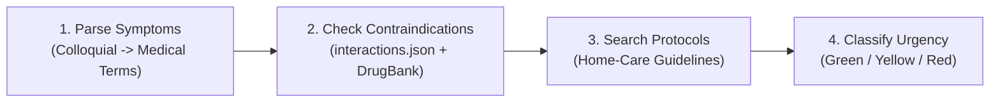

# 🏥 AURA: Patient Triage & Interaction Checker

[](https://github.com/himanshuraiml/agentx-challenge)
[](#)
[](#)
[-152238.svg)](#)
[](#)

> **Symptoms and current medications in, a triage summary with urgency out.**  
> An autonomous ReAct clinical decision-support agent with an interactive **Navy Blue & Warm Beige Claymorphism UI**, built for the **AgentX Challenge 2026** (SRMIST Tiruchirappalli).

---

## 📌 Executive Summary

Over **1.3 million emergency room visits** each year are linked to preventable adverse drug interactions and delayed triage. The **AURA Patient Triage & Interaction Checker** processes unstructured patient narratives, normalizes colloquial complaints into standardized medical terms, verifies potential contraindications against local pharmacological datasets (`interactions.json` and DrugBank CSV), references evidence-based home-care protocols, and stratifies urgency into a 3-tier clinical rating:

- 🟢 **GREEN**: Mild / Self-care with verified supportive home protocol.
- 🟡 **YELLOW**: Urgent / Clinic or telemedicine evaluation within 12–24 hours.
- 🔴 **RED**: Immediate Emergency / EMS dispatch or emergency department care required.

---

## 🎨 Interactive Claymorphism Frontend

A custom-designed, tactile **Claymorphism** interface designed with a clinical **Navy Blue (`#152238`) & Warm Beige (`#F8F5EE`)** palette:

* **Pillowy Claymorphism Aesthetic**: Soft inner and outer multi-layer shadows providing tactile 3D depth, rounded cards, and pill buttons.
* **Patient Intake Console**: Natural language complaint textarea with quick-symptom chips + dynamic medication tag manager.
* **4-Step Pipeline Visualizer**: Live step-by-step indicator showing term parsing, drug interaction verification, protocol retrieval, and acuity classification.
* **Clinical Triage Decision Output**: Color-coded urgency hero banner (Red/Yellow/Green), standardized medical nomenclature badges, and pharmacological risk warnings.
* **Quick Clinical Presets**: One-click scenario switcher for live demo presentations (🔴 *Warfarin + NSAID Bleed Risk*, 🟡 *Lisinopril + Hyperkalemia*, 🟢 *Mild Tension Cephalea*).
* **Live ReAct Execution Trace Inspector**: Dedicated terminal log drawer directly displaying the Thought -> Action -> Observation reasoning loop for judges and evaluators.

### Launch the Frontend
```bash
# Run the built-in HTTP server and API bridge (no extra packages needed):
python serve.py
```
Open **`http://localhost:8000`** in your browser, or double-click `frontend/index.html` to run in standalone browser mode.

---

## ⚡ The 4 Core Workflow Capabilities



1. **Parse Symptoms into Medical Terms**: Translates patient descriptions (e.g., *"terrible pounding head and room spinning"*) into clinical nomenclature (*Cephalea*, *Vertigo/Presyncope*).
2. **Flag Contraindications via Local Drug Tool**: Queries pairwise contraindications and mechanism of actions across `interactions.json` and tabular DrugBank CSVs (`data/drug_interactions_drugbank.csv`).
3. **Search Recent Home-Care Protocols**: Deterministically retrieves supportive management protocols from `homecare_protocols.json` with web search fallback for verified medical guidelines.
4. **Classify Urgency**: Dynamically stratifies risk into Green, Yellow, or Red using symptom severity and drug interaction risk matrices.

---

## 🚀 Quickstart (3 Steps)

### 1. Clone & Set Up Virtual Environment
```bash
git clone https://github.com/himanshuraiml/agentx-starter.git
cd agentx-starter
python -m venv venv
# On Linux/macOS:
source venv/bin/activate
# On Windows:
venv\Scripts\activate
pip install -r requirements.txt
```

### 2. Configure API Keys
Copy `.env.example` to `.env` and provide either a Gemini or Groq API key:
```bash
cp .env.example .env
```
Edit `.env`:
```ini
GEMINI_API_KEY="your-google-ai-studio-key"
# or
GROQ_API_KEY="your-groq-key"
AGENTX_PROVIDER="gemini" # or "groq"
```
*(Free API keys are available at [Google AI Studio](https://aistudio.google.com/apikey) and [Groq Console](https://console.groq.com/keys)).*

### 3. Run the Agent & Frontend

**Launch Claymorphism Web UI:**
```bash
python serve.py
# Opens at http://localhost:8000
```

**Dry-run (Works without API key — instant offline verification):**
```bash
python main.py --dry-run "Patient takes Warfarin, reports severe headache and wants to take Ibuprofen"
```

**Real agent run (Interactive CLI with full reasoning traces):**
```bash
python main.py "I am currently taking Lisinopril for hypertension. I have a dry cough and throat irritation. Can I take potassium supplements and cough syrup?"
```

**Judges' Headless Automated Test (`--json`):**
```bash
python main.py --json "Patient on Sildenafil reports chest tightness and took Nitroglycerin"
```

---

## ⚖️ The Judges' Evaluation Contract

This repository strictly complies with the automated evaluation harness contract:
- **`python main.py --json "<query>"`**: Emits **EXACTLY ONE JSON line** to `stdout`:
  ```json
  {"answer": "<Triage report>", "trace": [{"thought": "...", "tool": "...", "args": {...}, "observation": "..."}]}
  ```
- **Logging Separation**: All logs, debug traces, and telemetry are routed exclusively to `stderr`, guaranteeing clean JSON piping.
- **Dynamic File Reading**: Data is loaded dynamically from `AGENTX_DATA_DIR` (default `./data`). No hardcoded answers or paths.
- **Step Cap & Safety Guard**: Configured with loop detection and max iteration limits (`config.MAX_ITERATIONS`).

---

## 📂 Project Structure

```
agentx-starter/
├── README.md                      # Project documentation and quickstart
├── architecture.md               # Detailed system architecture and sequence flows
├── project_context.md            # Problem statement, clinical schemas, and UI design
├── implementation_plan.md        # Phase-by-phase engineering milestones
├── main.py                       # CLI entry point complying with judges' contract
├── serve.py                      # Claymorphism UI web server & /api/triage endpoint
├── frontend/
│   └── index.html                # Claymorphism SPA (Navy Blue & Warm Beige palette)
├── agent/
│   ├── __init__.py
│   ├── core.py                   # ReAct loop engine, error recovery, step caps
│   ├── llm.py                    # Multi-provider LLM interface (Gemini/Groq) with backoff
│   └── prompt_builder.py         # Clinical triage system prompt builder
├── config/
│   └── __init__.py               # Config parameters (MAX_ITERATIONS, AGENTX_DATA_DIR)
├── data/
│   ├── interactions.json         # High-acuity pairwise drug interactions & mechanisms
│   ├── drug_interactions_drugbank.csv # DrugBank interaction database
│   └── homecare_protocols.json   # Verified clinical home-care protocols
├── tools/
│   ├── __init__.py               # Tool registry (build_tools)
│   ├── symptom_parser.py         # Natural language to medical terminology mapping
│   ├── drug_interaction.py       # Local DrugBank and interactions.json query tool
│   ├── protocol_search.py        # Evidence-based home-care protocol search
│   ├── urgency_classifier.py     # 3-tier clinical urgency triage engine
│   ├── data_query.py             # File and SQL query primitives
│   └── web_search.py             # Medical web search fallback
└── tests/
    ├── test_agent.py             # ReAct loop offline tests
    └── test_medical_tools.py     # Tool validation tests
```

---

## 🧪 Running Tests

Verify tool execution, data queries, and the agent loop offline:
```bash
python -m unittest discover tests
```

---

## 📊 Scoring Alignment (100 Points Matrix)

| Criteria | Pts | Fulfillment in This Repository |
|---|---|---|
| **Agentic architecture & autonomy** | **40** | Autonomous ReAct loop with multi-step dynamic planning, tool retries, self-correction on tool failures, and anti-loop guards. |
| **Domain utility & execution** | **30** | Solves clinical triage realistically using `interactions.json` and real DrugBank interaction CSVs. Zero hardcoded responses. |
| **Code hygiene & system design** | **20** | Clean decoupling of agent brain, tool registry, CLI driver, and lightweight UI server. Verified judges' contract (`--json`), full unit test suite. |
| **Presentation & live demo** | **10** | Tactile Navy & Beige Claymorphism UI with real-time pipeline visualizer, one-click preset test scenarios, and live terminal ReAct trace viewer. |

---

## 🛡️ Medical Disclaimer
This agent is an engineering demonstration built for the AgentX Challenge 2026. It is intended for clinical triage decision-support evaluation and research purposes only and does not replace professional medical judgment. In emergencies, always contact local emergency services immediately.
