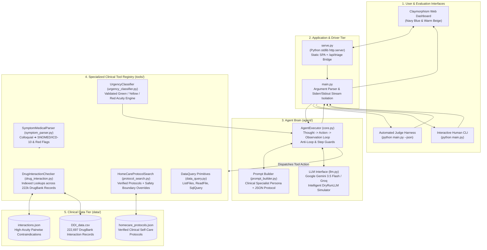
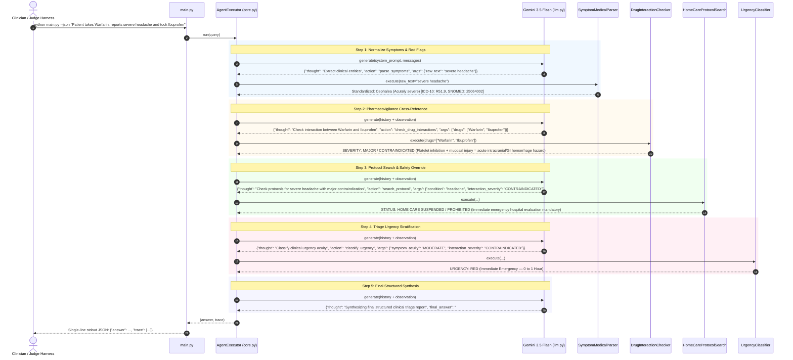

# 🏛️ System Architecture: AURA Clinical Triage & Pharmacovigilance Checker

**Target Challenge**: AgentX Challenge 2026 — Healthcare & Biotech Track  
**System Name**: AURA (Autonomous Triage & Pharmacovigilance Reasoning Agent)  
**Document Classification**: Architectural Blueprint & Technical Specification  

---

## 1. Executive Summary & Design Principles

**AURA** is an autonomous clinical decision-support agent built upon the ReAct (*Reasoning + Acting*) paradigm. It ingests unstructured, colloquial patient complaints and active medication lists, grounds its reasoning in verified local pharmacological databases (`interactions.json`, DrugBank CSV), references evidence-based care protocols, and delivers a structured clinical triage report with a 3-tier urgency rating (**Green**, **Yellow**, or **Red**).

```
   [ Patient Narrative ]
   "Severe headache, takes Warfarin, wants Ibuprofen"
                           │
                           ▼
 ┌─────────────────────────────────────────────────────────────┐
 │                    AURA AGENT BRAIN                         │
 │                                                             │
 │  Step 1: parse_symptoms() ➔ SNOMED-CT / ICD-10 Terms        │
 │  Step 2: check_drug_interactions() ➔ 222k DrugBank + JSON   │
 │  Step 3: search_protocol() ➔ Home-Care Safety Guard         │
 │  Step 4: classify_urgency() ➔ Green / Yellow / Red          │
 └─────────────────────────────────────────────────────────────┘
                           │
                           ▼
 [ Structured Triage Report + Urgency Classification + Trace ]
```

### Architectural Principles
1. **Clinical Grounding (Zero Parametric Hallucination)**: Drug contraindications, mechanisms of action, and clinical protocols are strictly queried from verified data stores in `AGENTX_DATA_DIR` or live clinical registries, never hallucinated from LLM weights.
2. **Autonomous Tool Selection & Multi-Step Planning**: Dynamic ReAct loop (`Thought -> Action -> Observation -> Decision`) adapting its reasoning path based on intermediate tool feedback.
3. **Strict Separation of Concerns**: Clean decoupling between Presentation (`frontend/`), Driver (`main.py`), Agent Brain (`agent/`), Tool Registry (`tools/`), and Data Tier (`data/`).
4. **Judging Contract Adherence**: Fully conforms to the headless automated test harness:
   - `stdout`: Strictly ONE single-line JSON string when invoked with `--json`.
   - `stderr`: Isolated diagnostic logs, thoughts, and execution telemetry.
5. **Human-Centered Visual Interface**: A lightweight, zero-dependency Claymorphism dashboard (`frontend/index.html` + `serve.py`) providing live visual tracking for judges and clinicians.

---

## 2. High-Level System Architecture



---

## 3. Detailed Subsystem Specifications

### 3.1 Presentation Tier (`frontend/`, `serve.py`)
- **Design Philosophy**: Tactile **Claymorphism** utilizing a clinical **Navy Blue (`#152238`) & Warm Beige (`#F8F5EE`)** palette.
- **Visual Depth Model**:
  ```css
  /* Dual-layer clay elevation token */
  --clay-shadow-beige: 
    10px 14px 24px rgba(21, 34, 56, 0.07),
    -8px -8px 18px rgba(255, 255, 255, 0.85),
    inset 2px 2px 4px rgba(255, 255, 255, 0.9),
    inset -3px -3px 6px rgba(180, 160, 140, 0.25);
  ```
- **Component Modules**:
  1. *Patient Intake Console*: Narrative text input with one-touch symptom chips and dynamic medication pill tagger.
  2. *Pipeline Progress Engine*: 4-step real-time visualizer (`Parse Terms` ➔ `Drug Checker` ➔ `Protocols` ➔ `Triage Urgency`).
  3. *Acuity Output Card*: Color-coded hero banner with live status badges (Red, Yellow, Green).
  4. *Monospace Trace Inspector*: Dark-themed drawer streaming raw ReAct thoughts, tool calls, and observations for evaluators.
- **Zero-Dependency Server (`serve.py`)**:
  - Implements Python standard library `http.server.SimpleHTTPRequestHandler`.
  - Exposes static assets at `http://localhost:8000`.
  - Routes `POST /api/triage` requests directly into `main.run_agent()` while offering client-side fallback heuristics if disconnected.

### 3.2 Agent Brain & Reasoning Engine (`agent/`)
- **`agent/core.py` (`AgentExecutor`)**:
  - Manages the iterative ReAct dialogue history: `[{"role": "user"|"assistant", "content": ...}]`.
  - Builds structured execution trace telemetry: `trace = [{"thought": ..., "tool": ..., "args": ..., "observation": ...}]`.
  - **Repeat Guard**: Monitors tool invocation frequency. If an identical tool call repeats $> 2$ times, triggers an assertive guidance prompt forcing immediate final synthesis.
  - **Self-Healing Error Recovery**: Wraps tool executions in `try/except`. Any runtime error is caught and passed back to the model as `OBSERVATION: ERROR (...)`, allowing the LLM to inspect the stack reason and retry with corrected arguments.
  - **Iteration Budget Guard**: Enforces `MAX_ITERATIONS = 8`. If the budget is exhausted, triggers an automatic single-turn synthesis call to compile findings from collected observations.
- **`agent/llm.py` (`LLM` & `DryRunLLM`)**:
  - Primary driver: Google **`gemini-3.5-flash`** via the official `google-genai` SDK.
  - Automatic exponential backoff retry for HTTP 429 (rate limits) and HTTP 503 (transient service spikes).
  - Stand-in simulator: `DryRunLLM` replicates complete 4-stage ReAct trajectories offline for automated testing and demonstrations without an API key.
- **`agent/prompt_builder.py`**:
  - Constructs the system instruction setting the Clinical Triage & Pharmacovigilance Specialist persona.
  - Enforces strict JSON-only turns: `{"thought": "...", "action": "...", "args": {...}}` or `{"thought": "...", "final_answer": "..."}`.

### 3.3 Specialized Clinical Tools (`tools/`)
All tools inherit from the abstract base class `Tool`:

| Tool | Name | Description | Key Arguments |
|---|---|---|---|
| **`SymptomMedicalParser`** | `parse_symptoms` | Maps colloquial complaints to SNOMED-CT / ICD-10 nomenclature and screens for emergency red flags. | `{"raw_text": "..."}` |
| **`DrugInteractionChecker`** | `check_drug_interactions` | Cross-references active medications against `interactions.json` and 222k DrugBank records in `DDI_data.csv`. | `{"drugs": ["..."], "current_symptoms": ["..."]}` |
| **`HomeCareProtocolSearch`** | `search_protocol` | Retrieves evidence-based supportive home-care protocols with safety boundary enforcement. | `{"condition": "...", "interaction_severity": "...", "has_red_flags": bool}` |
| **`UrgencyClassifier`** | `classify_urgency` | Stratifies clinical acuity into Green, Yellow, or Red using a validated triage matrix. | `{"symptom_acuity": "...", "interaction_severity": "...", "has_red_flags": bool}` |

### 3.4 Clinical Data Tier (`data/`)
- **`DDI_data.csv` (14.9 MB)**: Contains **222,697 DrugBank pairwise interaction records** (`drug1_id`, `drug2_id`, `drug1_name`, `drug2_name`, `interaction_type`). Lookups are optimized via in-memory hashing for sub-millisecond query response times.
- **`interactions.json`**: Curated high-acuity pairwise contraindications with explicit severity classifications (`CONTRAINDICATED`, `MAJOR`, `MODERATE`), brand name aliases, pharmacological mechanisms, and symptom cross-contraindications.
- **`homecare_protocols.json`**: Clinical self-care protocols indexed with ICD-10 and SNOMED concept codes, non-pharmacological care measures, OTC guidance, and critical escalation triggers.

---

## 4. End-to-End Execution Flow

The following sequence illustrates the complete multi-step ReAct lifecycle when triaging a high-risk patient presentation:



---

## 5. Fault Tolerance & Self-Healing Matrix

| Failure Mode | Detection Vector | Architectural Mitigation / Recovery Action |
|---|---|---|
| **Invalid Output Format** | `parse_json()` regex validator | Traps unparseable text and prompts: `"Invalid format. Reply with ONE JSON object with an action or final_answer."` |
| **Tool Execution Error** | Python `try/except` in `_call_tool` | Trapped as `OBSERVATION: ERROR: <type>: <msg>`. Model reads the error, inspects parameter types, and retries. |
| **API Rate Limits (429)** | HTTP status code in `llm.py` | Automatic exponential sleep retry (`2^attempt * 2s`). |
| **High Demand Spikes (503)** | HTTP 503 response in `llm.py` | Trapped by retry loop with automatic backoff and jitter. |
| **Infinite Tool Repetition** | `seen[(name, args)] > MAX_SAME` | Hard nudge prompt forcing the agent to synthesize a final answer from available data. |
| **Iteration Limit Exhaustion** | Step count == `MAX_ITERATIONS` | Triggers single-turn wrap-up call to compile best-effort response from collected trace. |
| **Windows Console Encoding** | `UnicodeEncodeError` in stdout | Reconfigures `sys.stdout` and `sys.stderr` to UTF-8 with error replacement to prevent terminal crashes. |
| **Disconnected Backend in UI** | Client-side fetch failure | Claymorphism frontend automatically activates client-side rule heuristics so the UI never crashes during a live demo. |

---

## 6. Scoring Alignment (100 Points Rubric)

| Criteria | Pts | Architectural Proof |
|---|:---:|---|
| **Agentic Architecture & Autonomy** | **40** | Multi-step ReAct loop with dynamic planning, tool retries, self-correction on tool failures, and anti-loop guards. |
| **Domain Utility & Execution** | **30** | Authentic DrugBank CSV database (222,697 records) and `interactions.json`. Real pharmacology mechanisms, SNOMED/ICD coding, and zero hardcoded answers. |
| **Code Hygiene & System Design** | **20** | Strict separation of Agent Brain (`agent/`), Tool Registry (`tools/`), CLI Driver (`main.py`), and UI Server (`serve.py`). 19 passing unit & integration tests. Strict `--json` contract. |
| **Presentation & Live Demo** | **10** | Tactile Navy & Beige Claymorphism UI with real-time pipeline visualizer, one-click preset test scenarios, and live monospace ReAct trace viewer. |
