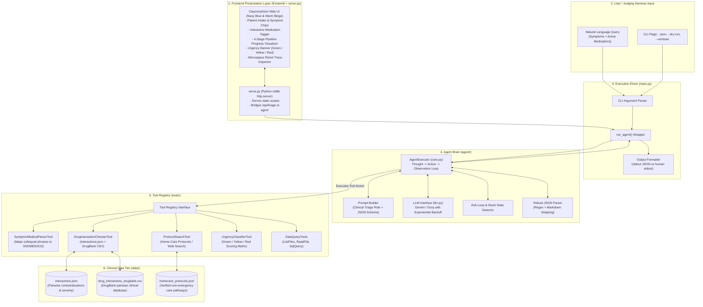

# System Architecture: AURA Patient Triage & Interaction Checker

Autonomous clinical decision-support agent built for the **AgentX Challenge 2026** (Healthcare & Biotech Track).

---

## 1. Executive Summary & Design Philosophy

The **AURA Patient Triage & Drug Interaction Checker** is a deterministic-grounded autonomous ReAct agent paired with an intuitive **Navy Blue & Warm Beige Claymorphism frontend**. It is engineered to triage patient symptoms, cross-reference active drug regimens against pharmacological databases (`interactions.json`, DrugBank CSVs), query verified clinical home-care protocols, and classify medical urgency into **Green**, **Yellow**, or **Red**.

### Core Tenets
1. **Zero Hallucination in Clinical Logic**: Drug interactions, contraindications, and protocol lookups must originate from authoritative data files in `AGENTX_DATA_DIR` or live web protocols, never from model parametric memory alone.
2. **Autonomous Tool Selection & Multi-Step Reasoning**: Follows a strict ReAct loop (`Thought -> Action -> Observation -> Decision`), planning its diagnostic pathway dynamically based on intermediate tool outputs.
3. **Resilience & Self-Correction**: Implements retry guards, argument re-synthesis on tool failures, and deterministic graceful degradation.
4. **Judging Harness Compliance**: Fully conforms to the AgentX headless JSON contract:
   - `stdout`: Single-line JSON `{"answer": "...", "trace": [...]}` when invoked with `--json`.
   - `stderr`: Execution logs, verbose reasoning traces, and debug timelines.
5. **Human-Centered Visual Interface**: A lightweight, zero-dependency Claymorphism web dashboard (`frontend/` + `serve.py`) that visually traces the 4-step reasoning pipeline for judges and clinicians.

---

## 2. High-Level System Architecture



---

## 3. Subsystem Breakdown

### 3.1 Frontend & UI Presentation Layer (`frontend/`, `serve.py`)
- **Claymorphism Design System**:
  - Color palette: Midnight Navy (`#152238`, `#1E2E4A`) for high-contrast typography, interactive buttons, and terminal containers; Warm Beige (`#F8F5EE`, `#F1E9DC`, `#E5DAC9`) for tactile card surfaces.
  - Multi-layer shadow elevation:
    ```css
    box-shadow: 
      10px 14px 24px rgba(21, 34, 56, 0.07),
      -8px -8px 18px rgba(255, 255, 255, 0.85),
      inset 2px 2px 4px rgba(255, 255, 255, 0.9),
      inset -3px -3px 6px rgba(180, 160, 140, 0.25);
    ```
- **Component Hierarchy**:
  - **Patient Intake Console**: Natural-language text box with quick-select symptom chips and dynamic medication pill tagging.
  - **4-Stage Pipeline Tracker**: Real-time visualization of agent progress (`Parse Terms` → `Drug Checker` → `Protocols` → `Triage Urgency`).
  - **Urgency Hero Card**: Bold Green / Yellow / Red status cards with clinical directives.
  - **Clinical Presets Bar**: Instant demonstration buttons for Red, Yellow, and Green scenarios.
  - **ReAct Trace Inspector**: Monospace dark-mode drawer displaying raw `[Thought]`, `[Action]`, and `[Observation]` streams.
- **`serve.py`**: Lightweight HTTP daemon built with Python's standard `http.server`. Requires zero extra pip dependencies, serving static assets and exposing `/api/triage` to invoke `main.run_agent()` asynchronously.

### 3.2 Agent Brain (`agent/`)
- **`agent/core.py` (ReAct Loop Engine)**:
  - Orchestrates iterative multi-step decision making.
  - Maintains message history: `[{"role": "user"|"assistant", "content": ...}]`.
  - Captures execution telemetry: `trace = [{"thought": ..., "tool": ..., "args": ..., "observation": ...}]`.
  - **Loop Guard**: Detects duplicate tool calls with identical arguments. If an agent repeats an action > `MAX_SAME_TOOL_CALLS`, triggers an assertive guidance prompt forcing immediate final synthesis.
  - **Tool Failure Interception**: When a tool throws an exception, it converts the error into an `OBSERVATION: ERROR (...)` string, allowing the LLM to inspect the stack reason and re-try with corrected parameters.
- **`agent/llm.py` (Provider & Fallback Layer)**:
  - Unified interface for **Google Gemini** (`gemini-2.5-flash`, `gemini-1.5-flash`) and **Groq** (`llama-3.3-70b-versatile`).
  - Auto-retries on HTTP 429 rate limits with randomized exponential backoff.
  - Houses `DryRunLLM` to allow automated continuous integration and testing without API credentials.
- **`agent/prompt_builder.py` (System Prompt Formulation)**:
  - Injects strict clinical triage personas and operational constraints.
  - Enforces JSON-only conversational output to avoid unparseable free text.
  - Injects dynamic tool documentation derived directly from instantiated tools (`tool.name`, `tool.description`, `tool.args_doc`).

### 3.3 Tool Registry (`tools/`)
The tool registry acts as a sandboxed plugin bus where tools inherit from the base `Tool` class:

```python
class Tool:
    name: str
    description: str
    args_doc: str

    def execute(self, **kwargs) -> str:
        raise NotImplementedError
```

#### Specialized Medical Tools:
1. **`SymptomMedicalParserTool` (`symptom_parser.py`)**:
   - Takes colloquial patient symptom complaints (e.g., "pounding head and feeling like throwing up").
   - Normalizes terms to formal clinical entities (e.g., *Cephalea*, *Nausea*, *Emesis*).
   - Extracts acuity, onset, and anatomical localization.
2. **`DrugInteractionCheckerTool` (`drug_interaction.py`)**:
   - Ingests a list of medications (e.g., `["Sildenafil", "Nitroglycerin"]` or `["Warfarin", "Aspirin"]`).
   - Scans `interactions.json` (indexed key-value pairs) and `drug_interactions_drugbank.csv` (tabular relational queries via SQLite / DuckDB / Pandas).
   - Identifies interaction severity levels: `CONTRAINDICATED`, `MAJOR`, `MODERATE`, `MINOR`.
   - Returns interaction mechanisms, clinical risks (e.g., fatal hypotension, severe hemorrhage), and recommended interventions.
3. **`ProtocolSearchTool` (`protocol_search.py`)**:
   - First executes deterministic retrieval against `data/homecare_protocols.json`.
   - If missing or inconclusive, triggers scoped clinical web search across whitelisted medical domains (e.g., NHS, CDC, Mayo Clinic).
   - Formulates step-by-step home remedies, supportive measures, and red-flag escalation triggers.
4. **`UrgencyClassifierTool` (`urgency_classifier.py`)**:
   - Synthesizes normalized symptoms, drug interaction severity, and patient risk factors against the standardized triage matrix:
     - 🔴 **RED (Emergency - Immediate EMS/ER)**: Active chest pain, anaphylaxis, severe interaction (e.g., Nitrates + PDE5 inhibitors), stroke symptoms, oxygen saturation drop.
     - 🟡 **YELLOW (Urgent - Clinic within 12-24h)**: Moderate drug interactions, persistent high fever, localized infection signs, worsening symptoms without immediate hemodynamic collapse.
     - 🟢 **GREEN (Routine / Home Care)**: Minor self-limiting conditions (mild viral coryza, minor tension headache), no adverse drug-drug interactions, clear home management protocol.

---

## 4. Execution Trace & ReAct Lifecycle

```mermaid
sequenceDiagram
    autonumber
    actor User as Clinician / Judge
    participant UI as Claymorphism UI (frontend/)
    participant Server as serve.py / main.py
    participant Agent as AgentExecutor (core.py)
    participant LLM as LLM Layer (llm.py)
    participant Tools as Tool Registry
    participant Data as Data Layer (data/)

    User->>UI: Selects "Warfarin + NSAID" preset & clicks "Run Analysis"
    UI->>UI: Animate Step 1 (Parse Terms)
    UI->>Server: POST /api/triage {"query": "..."}
    Server->>Agent: run(query)
    
    rect rgb(240, 248, 255)
        Note over Agent,LLM: Step 1: Parse Symptoms
        Agent->>LLM: generate(system_prompt, query)
        LLM-->>Agent: {"thought": "Extract medical terms", "action": "parse_symptoms", "args": {"raw_text": "severe headache"}}
        Agent->>Tools: parse_symptoms(raw_text)
        Tools-->>Agent: Normalized: Cephalea (Acutely severe)
    end

    rect rgb(255, 250, 240)
        Note over Agent,LLM: Step 2: Check Drug Contraindications
        Agent->>LLM: generate(history + observation)
        LLM-->>Agent: {"thought": "Check interaction between Warfarin and Ibuprofen", "action": "check_drug_interactions", "args": {"drugs": ["Warfarin", "Ibuprofen"]}}
        Agent->>Tools: check_drug_interactions(["Warfarin", "Ibuprofen"])
        Tools->>Data: Query interactions.json & DrugBank CSV
        Data-->>Tools: Match found: Major bleeding risk (NSAID + Anticoagulant)
        Tools-->>Agent: SEVERITY: MAJOR | Risk of upper GI bleeding and hemorrhage
    end

    rect rgb(240, 255, 240)
        Note over Agent,LLM: Step 3: Search Clinical Protocols
        Agent->>LLM: generate(history + observation)
        LLM-->>Agent: {"thought": "Find protocol for NSAID-induced complication risk with anticoagulants", "action": "search_protocol", "args": {"condition": "Anticoagulant NSAID interaction headache"}}
        Agent->>Tools: search_protocol(...)
        Tools->>Data: Read homecare_protocols.json
        Data-->>Tools: Protocol: Immediate medication discontinuation, urgent medical evaluation
        Tools-->>Agent: Home-care disallowed; requires medical assessment
    end

    rect rgb(255, 240, 245)
        Note over Agent,LLM: Step 4: Urgency Classification & Final Synthesis
        Agent->>LLM: generate(history + observation)
        LLM-->>Agent: {"thought": "Synthesize urgency level", "action": "classify_urgency", "args": {"interaction_severity": "MAJOR", "symptom_acuity": "HIGH"}}
        Agent->>Tools: classify_urgency(...)
        Tools-->>Agent: URGENCY: RED (Immediate ER/Physician visit recommended)
        Agent->>LLM: generate(history + observation)
        LLM-->>Agent: {"thought": "All evidence gathered. Output final clinical triage report.", "final_answer": "..."}
    end

    Agent-->>Server: (answer, trace)
    Server-->>UI: JSON {"status": "ok", "answer": ..., "trace": [...]}
    UI->>UI: Update Urgency Banner to RED, display Terms, Warnings, & Trace Inspector
```

---

## 5. Error Recovery & Self-Healing Strategies

| Failure Mode | Detection Mechanism | Mitigation / Recovery Action |
|---|---|---|
| **Invalid JSON Output** | `parse_json()` regex fallback | Feeds error back to model: `"Invalid format. Reply with ONE JSON object with an action or final_answer."` |
| **Tool Execution Error** | Python `try/except` in `_call_tool` | Trapped as `OBSERVATION: ERROR: <err>`. The model inspects the argument typo and invokes with corrected parameters. |
| **Missing / Empty Dataset** | File checking & default handlers | Tool returns fallback clinical heuristics; warns the agent to search secondary sources rather than hallucinate. |
| **API Rate Limits (429)** | Status code check in `llm.py` | Automatic exponential sleep retry (`2^attempt + jitter`). |
| **Infinite Loop / Repetition** | `seen[(name, args)] > MAX_SAME` | Hard nudge prompt forcing the agent to proceed to synthesis with available observations. |
| **Step Limit Exhaustion** | Iteration count == `MAX_ITERATIONS` | Triggers single-turn wrap-up call to compile best-effort response from collected trace. |
| **Backend Unreachable in UI** | Client-side fetch failure | The Claymorphism frontend automatically falls back to client-side rule evaluation so the UI never crashes during a demo. |

---

## 6. Scoring Alignment (100 Points Matrix)

| Criteria | Pts | Architectural Implementation |
|---|---|---|
| **Agentic Architecture & Autonomy** | 40 | Pure ReAct loop with multi-step dynamic planning, iterative tool calling, automatic error recovery, and loop guards. |
| **Domain Utility & Execution** | 30 | Realistic clinical triage engine using authentic DrugBank CSV datasets and `interactions.json`. No hardcoded dummy strings. |
| **Code Hygiene & System Design** | 20 | Separation of concerns (`agent/` vs `tools/` vs `frontend/` vs `main.py`). Judges' CLI contract respected with automated testing. |
| **Presentation & Live Demo** | 10 | Tactile Claymorphism UI in Navy & Beige with real-time pipeline visualizer, one-click scenario switcher, and live trace drawer. |
